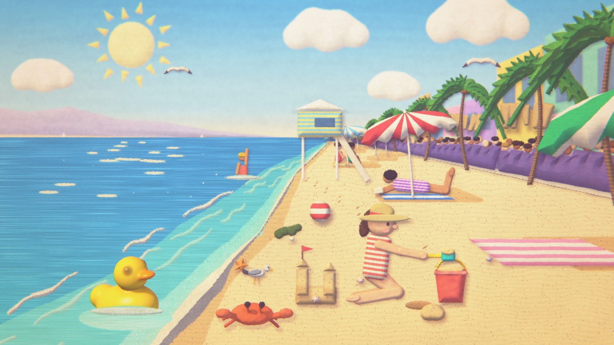

# Elaborate Backgrounds (work in progress)

Looping stop-motion backgrounds in the browser, in two parts:

- **The garden study** ([index.html](index.html)). A real-time WebGL2 recreation of the feel of a looping stop-motion backdrop: a handmade-looking fantasy garden with a waterfall, swaying flowers and a soft, warm, fuzzy filter. It's built as layered parallax quads on a stepped stop-motion clock, with a post stack on top.
- **The editor** ([editor.html](editor.html)). The study's recipe, turned into a tool for making your own wallpapers: layers at depths, ready-made pieces from a store, shapes you cut and texture yourself, and the whole look as switches and sliders. It exports PNG stills, video loops and scene files.
- **Beach day**, the editor's sample scene ([js/scenes/beach.js](js/scenes/beach.js)). A girl in a sun hat scoops sand into her bucket while waves roll in, palms sway, gulls fly past and a boardwalk crowd chatters in cardboard quote marks. Every piece is an ordinary editor shape, so all of it can be opened and changed.



**The study is a study.** The original backdrop was made by Tamara for a podcast set. The show isn't named here, and I'm not affiliated with it. The study's art is entirely procedural (shader code, no images), written by Claude at my direction. So are the editor's starter pieces, which say so in the store, and the Beach day sample, which Claude built from the editor's own pieces. My own scenes and materials, photographed and drawn by me, come next and are the actual portfolio piece.

Status: phases 1 to 6 are done: the analysis, the rendering skeleton, the study, the first version of the editor, the customizer and store (drawing and editing outlines, animating pose by pose, cut-outs from photos, real boil, My pieces and packs), 3D pieces sculpted from clay, felt or plastic parts, and wallpaper output (exact video loops, a live wallpaper file and player, and scenes in any screen shape). What's left is in [docs/PLAN.md](docs/PLAN.md). The write-up of the look is in [docs/RECIPE.md](docs/RECIPE.md).

## Running it

There's no build step and no dependencies. Serve the folder with any static server:

```sh
python -m http.server
# then open http://localhost:8000 for the study, http://localhost:8000/editor.html for the editor,
# or http://localhost:8000/player.html for the player (?sample=garden, ?scene=file.json, &controls=1)
```

The study's URL switches, mostly for comparing ingredients:

| Switch | Does |
| --- | --- |
| `?grade=measured` | The grade matched to the reference's measured numbers, instead of the warm default |
| `?upto=base` (or `depth`, `bloom`, `halation`, `grade`, `ca`, `vignette`) | Turns the post passes on in order, up to and including that one |
| `?fps=8` (or `12`, `6`) | Stop-motion rate |
| `?boil=0`, `?motion=0` | No boil, or no animation |
| `?grain=frame` | Grain changes every rendered frame instead of once per beat |
| `?t=2.5` | Freeze at that point in the 6-second loop |
| `?stats=1` | Live frame times |

## Using the editor

The first time, it opens the Beach day sample, with a short tour. **File, New scene** starts from a blank backdrop, the sample, or the garden study, each with every piece editable. How the interface is designed, and why, is in [docs/UI.md](docs/UI.md).

- **The layout.**
  - The **+** button (or A) opens the store.
  - The rail below it has the tools.
  - **Layers** is on the left and the canvas in the middle.
  - The timeline sits under the canvas.
  - The inspector on the right has three tabs: **Piece**, **Layer** and **Look**. The tab follows what you select.
- **Layers.**
  - Each row has a number (1 is the front), a colored bar for its depth (cool far, warm near), a live thumbnail, and badges for poses and motion.
  - The **depth view** above the list shows every layer as a card standing at its depth. Point at the diagram and it magnifies around the pointer, like a dock, so you can slide from layer to layer; the one under the pointer turns to face you, larger, so you can see what's in it. Hovering a row in the list does the same.
  - Drag rows to restack, double-click a name (or press F2) to rename, and right-click for everything else.
  - Alt+Up and Alt+Down restack from the keyboard.
- **The view.**
  - Ctrl + wheel (or a pinch) zooms at the pointer. The wheel pans, and so do Space + drag, the hand tool (H) and the middle button.
  - Ctrl+0 fits the scene, and Ctrl+1 is 100%: the scene at 1080 pixels tall.
  - **G** shows the slice a phone, a desktop and an ultrawide screen would show.
  - **F** presents the scene full screen.
- **Objects and groups.**
  - A layer can hold many objects. Each object is a group of pieces, the way a drawing program groups shapes. Beach day's front layer holds the girl, her bucket and sandcastle, and the crab.
  - Click a grouped piece and the whole group is selected: drag, scale or turn it as one. Double-click to reach a single piece inside.
  - Shift-click pieces in one layer to select several, then Ctrl+G groups them; Ctrl+Shift+G ungroups. In Layers, groups are folder rows you can fold, rename (double-click or F2) and restack.
  - **Merge into another layer…** (right-click a layer) moves all of its pieces into another one as a group. **Give it a layer of its own** does the opposite.
  - A still store piece made of several parts, like the umbrella, joins the selected layer as a group instead of starting a new layer.
  - What has to stay in its own layer: something that sways, drifts or flies across (motion belongs to a layer), and anything whose poses run on a different timing, since a layer has one pose timing. Merging says so when it can't.
- **Select and move.**
  - Click a piece to select it, then drag it. Moving snaps to the frame's edges and middle and to other pieces, with pink guide lines; hold Alt to move freely.
  - Any corner handle scales, and the round handle rotates (Shift snaps to 15°).
  - Select a layer and drag inside its dashed box to move the whole layer.
- **Draw.** Pick a shape tool (R rectangle, E ellipse, T triangle, S star, C cloud) and drag on the canvas. New pieces go into the selected layer, or into a new layer if none can take them.
- **Your own outlines.**
  - The pen tool (P) places points. Click the first point, double-click or press Enter to close the shape.
  - To edit the points, double-click a custom outline, or press Enter with the canvas focused.
  - Drag a point to move it, drag a + to add one, and Alt-click a point to remove it.
  - From the keyboard, [ and ] pick a point, the arrows move it, + adds one after it and Delete removes it.
- **Changing a piece.**
  - The Piece tab has a header with the piece's picture, its name, its layer and quick actions.
  - Below that are cards: Place, Outline, Material (rendered swatches in the piece's own colors), Handmade feel, and whatever else that kind of piece has.
  - Drag any number's label sideways to scrub it, and double-click the label to reset it.
- **Animate.**
  - Give a layer poses in the Layer tab (2 to 12, at a rate that fits the loop). Pose buttons appear under the canvas, and , and . step through them.
  - With **This pose** on, moving, scaling or rotating a piece changes just the pose on screen.
  - **Onion skin** shows the previous pose faintly, **Copy previous pose** starts a new pose from the last one, and a piece can be hidden in single poses.
- **Cut-outs from photos.**
  - Import a photo of a paper shape, select it, and use **Turn into a cut-out**.
  - The editor guesses whether the shape is dark on light, light on dark, or a see-through PNG. You can change that, and move where the edge falls, with the Cut out settings.
  - It then gets a handmade edge, puff and shadow like any shape.
- **Real boil.** On a picture or cut-out, pick a second and third photo of the same object under Boil photos. They swap on the beat.
- **3D pieces.**
  - The 3D group in the store has a rubber duck, a mushroom, a crab, a pebble stack, a felt bird and a spinning duck.
  - A 3D piece is made of up to 16 parts (balls, tapered tubes, rounded boxes and eggs) that blend like pressed clay, and a part can be cut away to make a hollow.
  - Double-click the piece, or press Enter, to pick and drag its parts on the canvas.
  - **Turntable**, **Bounce** and **Wobble** animate it in one click, moving it to its own layer first if it shares one.
- **Store.**
  - Search looks through every group.
  - Click a piece and it flies into the middle of the view, or drag it to a spot.
  - **Import picture**, or dropping image files on the canvas, adds your own pictures. A shape's material can also be **Photo**, which fills it with one of them.
- **My pieces and packs.**
  - **Save to My pieces** (from a piece's or a layer's header, or the right-click menu) keeps it in this browser, under My pieces in the store.
  - **Save as a pack** writes them all to one file with your name and a license line.
  - **Install a pack** adds someone else's pack as its own store group.
- **Look.** Presets shown as small renders of your scene, the beat rate, the boil, the grade, and each post pass, each with a switch in its card.
- **Light or dark.** The sun and moon button in the top bar switches between the Studio (dark) and Paper (light) themes.
- **Keys.** **?** shows every shortcut. The common ones:
  - Ctrl+Z and Ctrl+Shift+Z undo and redo. A delete also offers Undo in its message.
  - Ctrl+S saves the scene file, Ctrl+O opens one, and Ctrl+E exports.
  - Ctrl+D duplicates. A tap of Space plays or pauses.
  - On the canvas, the arrows move the selection (add Shift to move further), Delete removes it and Escape deselects.
  - [ and ] move the selection backward or forward. , and . step through poses.
- **Screen shapes.** **New scene** makes a blank scene for a desktop (16:9), an ultrawide (21:9), a laptop (16:10), a square or a phone (tall). In Look, two sliders set where a crop centers; press G to see the crops.
- **Saving and exporting.** The scene autosaves in this browser; the chip by its name shows when. **File, Save the scene file** downloads a .json scene file (format in [docs/SCENE-FORMAT.md](docs/SCENE-FORMAT.md)), with your pictures embedded. **Export** offers four things:
  - a PNG, at sizes that fit the scene listed first;
  - an MP4 video of one, 2 or 5 loops, rendered beat by beat so it loops exactly;
  - a **live wallpaper**: one self-contained HTML file that plays the scene full screen, for apps that use a web page as a wallpaper, or as a page background;
  - the scene file.

## Quality checks

Measured in Chrome 156 on this laptop (Intel Iris Xe, integrated graphics), driven by scripts through the DevTools protocol.

| Check | Result |
| --- | --- |
| The study, before and after the editor's engine changes | Same pixels at `?t=2.5`: largest difference 1 of 255, except where the new "Make your own" link sits in the caption |
| Editor ready, study scene loaded | 1.1 to 1.3 s (three runs, before Beach day) |
| Editor ready, Beach day loaded | 2.8 s (two runs): 1.8 s compiling the shape shader, 70 to 80 ms baking 125 textures. It was 2.4 to 2.6 s before cut-outs and smooth outlines. |
| Phase 5, scripted end to end | Pen outline of 5 points; point drag, Alt-click removal, keyboard add and move; smoothing; 4 poses with a move in pose 2 only, copy previous pose and onion skin; a photographed paper star turned into a cut-out (guessed "dark on light"); boil photos; save to My pieces, export a pack, delete, reinstall and add from it. All behaved as described. A file that isn't a pack was refused with a message. |
| 3D, scripted end to end | Added the duck from the store; turned it from the panel; added a part; picked and dragged a part on the canvas and from the keyboard; undid both; made a 12-pose turntable (344 ms from the click to the redrawn canvas). All behaved as described. |
| 3D shader compile | 277 ms on its own; with Beach day it compiles alongside the shape shader, and the editor was ready in 2.6 to 2.7 s (two runs, 141 textures) |
| Cut-out click testing | A red disc of radius 0.12: hit at 0.11 from its center, missed at 0.14 and in the empty corner |
| Beach day texture memory | About 78 MB at a 900 px tall bake (this test window). A 1080p screen bakes denser, so expect about 1.8 times that. |
| Beach day, a new beat | 0.2 ms median, 0.3 ms p95 to draw (30 beats, 976×549 canvas) |
| Beach day file round trip | Identical text, no warnings, 436 KB |
| Rebake after moving one piece, in the study's busiest layers | Median 0.6 to 1.2 ms, worst 6.8 ms (8 moves per layer, three runs) |
| Rebake after moving one of 25 shapes in one layer | 0.5 to 1.7 ms |
| Scene file round trip (save, open, save) | Identical text |
| Exact video loop | Beach day exported with WebCodecs (H.264) and the project's own MP4 writer. Each file was read back twice: from its own boxes, and by Chrome's video player. First and last frames decoded to real pictures. Results are in the table below. |
| Real-time fallback | For browsers without frame-by-frame encoding: MP4 or WebM recorded live, 5.94 to 5.96 s, so the last beat runs about 50 ms short |
| Live wallpaper file | 783 KB for Beach day with everything inline. Played on its own from another folder, it drew 12 frames a second, one per beat, and asked for 25 animation frames in 2 seconds, where a 60 Hz loop asks for 120. |
| Player page | The pause button (?controls=1) stopped all drawing; reduced motion didn't autoplay; axe found no violations |
| Screen shapes | Blank phone, ultrawide and square scenes got a canvas in their own shape, and their own sizes first in Export. The crop sliders now move the view at once; before, they waited for a window resize. |
| axe-core 4.10 scan, editor | No violations with nothing selected, a piece selected, the Look tab, and the Export dialog; again in Beach day with a gull layer and one of the girl's pieces selected; and with an installed pack open, and with the pose strip showing |
| axe-core 4.10 scan, study page | No violations |
| Reduced motion | The editor doesn't autoplay; the play button reads "Play" |
| Width 420 px | No sideways scrolling; canvas first, then the panels. Selecting a piece no longer scrolls the page to the layer list. |
| The new interface, scripted end to end | 20 checks, all passing: draw with a tool; open the store with A; search; add by clicking; close with Escape; drag a layer row to the top; row numbers; Ctrl+wheel zoom at the pointer and wheel pan; Ctrl+0 to fit; a still export while zoomed in (the whole scene, and the zoom comes back); the right-click menu; delete with Undo from the toast; a tap of Space; the menubar with arrow keys; the shortcut sheet; present mode; the theme switch; the tour; 8 beats a second |
| axe-core 4.10 scan, new interface | No violations in nine states across both themes: nothing selected, a shape, a 3D piece, the Layer tab with poses, the Look tab, and the store open |
| Older suites, rerun on the new interface | Phase 5 (pen, points, poses, cut-out, boil, packs), phase 6 (3D parts, turntable), Beach day, screen shapes, the garden study, the exact video loop (1920 × 1080: 6.000 s, 72 frames) and the live wallpaper (12 draws a second; pauses fully) all give the same results as before |
| The study page after this phase | Pixel-identical to the last commit at `?t=2.5` |
| Groups, scripted end to end | 19 checks, all passing: Beach day now has 31 layers (from 37), with the girl, her bucket and sandcastle, and the crab in one layer; a click selects the girl's group of 27 pieces; dragging moves all 27 by the same amount, and undo restores them; Size 150% from the inspector; double-click reaches one piece; folder rows in Layers; Shift-click, Ctrl+G, restack as one block, Ctrl+Shift+G; a store umbrella joins the selected layer as a group while a swaying palm gets its own; merging refuses a swaying layer with a reason, and merges a still one as a group; groups survive a save and reopen unchanged |
| Beach day, before and after merging layers | At beat 30 (1280 × 720): mean difference 0.5 of 255; 3% of pixels differ by more than 8, from the boil's wobble and the small depth changes of the merged pieces |
| The depth view's turning card | Sweeping the pointer across the diagram in 2 px steps reached all 31 Beach day layers, in depth order, without skipping one. With the pointer in the middle, the neighbours sat 47 and 62 units from the hovered card (evenly spaced, they'd be 7 apart). Hovering a row turns its card too; moving away turns it back. axe found no violations with the card turned, or with a group selected. |
| Editor ready, Beach day, on this laptop's Iris Xe GPU | 1.8 to 1.9 s, against 1.4 to 1.6 s before this phase (two runs each). The extra time is the browser drawing the richer interface while the shaders compile. |
| Thumbnails | All 37 layer thumbnails and 31 store thumbnails are drawn about 6 s after the editor is ready, one at a time when the renderer is free (headless test, software GPU) |
| One step of a drag on the canvas | 2.8 to 3.2 ms median, 5 to 7 ms p95, including the inspector and the overlay (40 steps, Beach day) |

Exact video exports of Beach day, measured:

| Size | Loops | Length (file and player) | Frames | File size | Time to export |
| --- | --- | --- | --- | --- | --- |
| 1280 × 720 | 1 | 6.000 s | 72 | 2.3 MB | 0.9 s |
| 1920 × 1080 | 5 | 30.000 s | 360 | 23.8 MB | 4.0 s |
| 3840 × 2160 | 1 | 6.000 s | 72 | 18.7 MB | 5.6 s |
| 1080 × 1920 | 1 | 6.000 s | 72 | 5.4 MB | 1.2 s |

Keyboard: every control in the panels is a native button, input or select with a visible label, and the canvas takes the arrow keys when focused. Moving pieces precisely without a mouse goes through the Placement sliders. The handles themselves need a mouse or touch.

Not measured yet: Lighthouse, frame times on a phone, and touch use. Handles are 11 px and outline points 10 px, which is small for fingers.

Measurement note: the timings above this phase were taken in headless Chrome with a software GPU, which is slower to compile shaders. On this laptop's Iris Xe, Beach day was ready in 1.4 to 1.6 s at the last commit.

## Code tour

```
index.html                 The study page, caption and play/pause control
editor.html                The editor
player.html                The player: a scene full screen, as a wallpaper or a page background
css/tokens.css             The portfolio's tokens (copied from Resume/css/style.css)
css/site.css               The study page's chrome
css/editor.css             The editor's look: both themes, every component, the motion (see docs/UI.md)
js/gl.js                   WebGL2 helpers, including parallel shader compiling
js/clock.js                The stepped clock and the 6-second loop
js/materials.js            Procedural material library: noise, fibers, foliage, paper, clay, beads, light
js/elements.js             Reusable art elements (canopy, florets, trunk, turf...) and the flower/leaf sprite shader
js/shapes.js               Shapes people make (outline, material, rough edge, puff, shadow), cut-outs and imported images
js/clay.js                 3D pieces: parts blended like clay, raymarched once per pose when a layer bakes
js/items.js                Piece geometry: move/scale/rotate transforms, bounds, hit testing
js/post.js                 Post-processing shaders
js/renderer.js             Baking (only what changed), compositing, parallax, boil, the post stack
js/scenes/garden.js        The study as data: layers, depth, motion, grades
js/scenes/garden-art.js    The study's bespoke shaders (sky, clouds, hills, waterfall...)
js/scenes/beach.js         The Beach day sample, built from editor shapes in a one-point perspective
js/app.js                  The study page: boot, reduced motion, pause when hidden, fallbacks
js/editor/doc.js           The scene document: checking files, look presets, undo, autosave
js/editor/library.js       The store's pieces and their credits
js/editor/actions.js       Editing actions shared by panels, canvas and keys
js/editor/ui.js            Shared interface pieces: icons, toasts, menus, tooltips, motion helpers, depth colors
js/editor/fields.js        Section cards and controls (scrubbing numbers, swatches, pickers) built from small definitions
js/editor/layers.js        The Layers panel: numbered rows, live thumbnails, the depth view, drag to restack
js/editor/store.js         The store drawer: search, groups, cards, My pieces and packs
js/editor/panels.js        The inspector: Piece, Layer and Look tabs
js/editor/canvas.js        Zoom and pan, the selection overlay, handles, snapping, drawing, drops, right-click menus
js/editor/export.js        Scene files, PNG stills, exact video loops, live wallpaper files
js/editor/mp4.js           A small MP4 writer for one H.264 track (for exact loops)
js/player.js               The player behind player.html and exported live wallpapers
js/editor/main.js          Editor boot, frame loop, menubar, timeline, toasts, themes, shortcuts, present mode, tour
tools/sample_palette.py    Samples colors and tone stats from reference frames or renders
```
