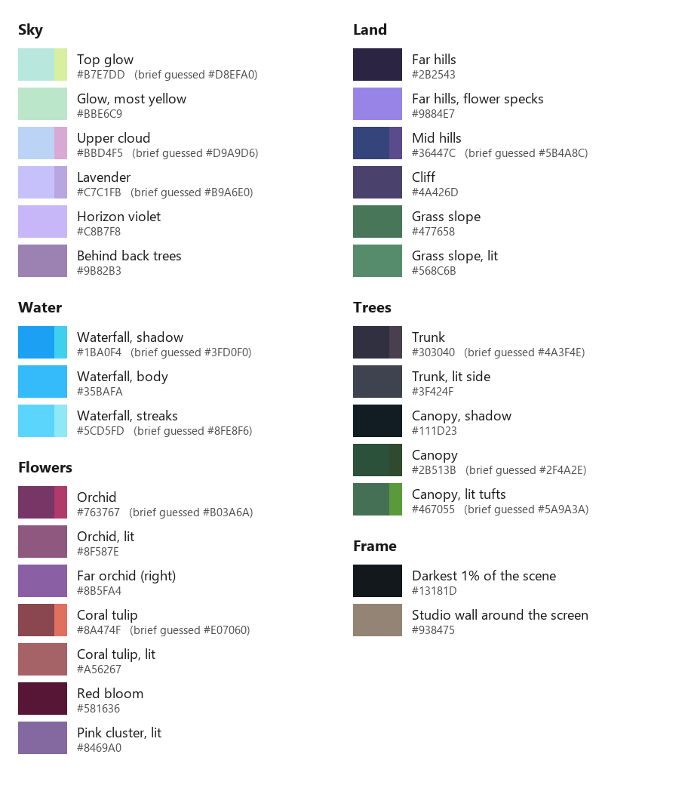
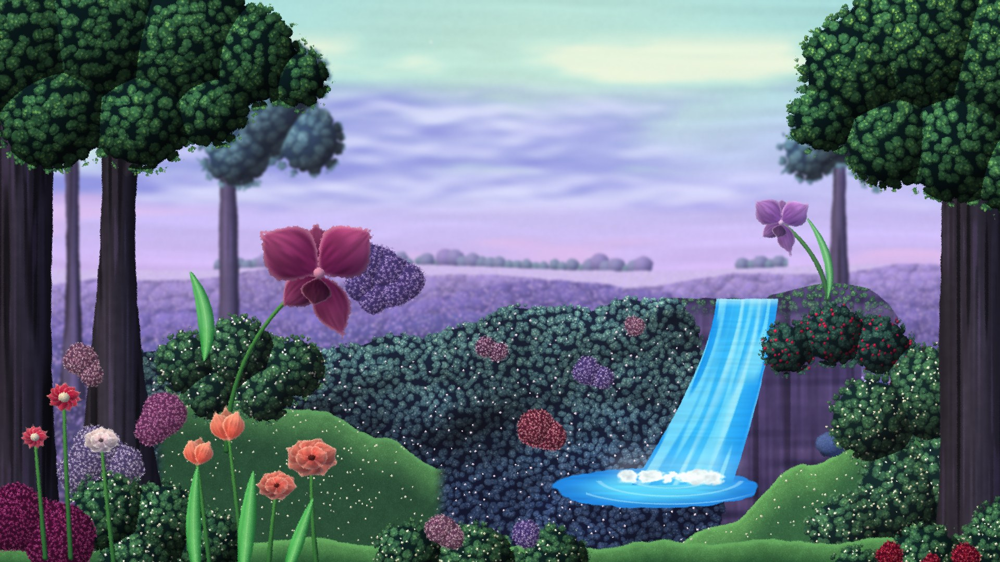
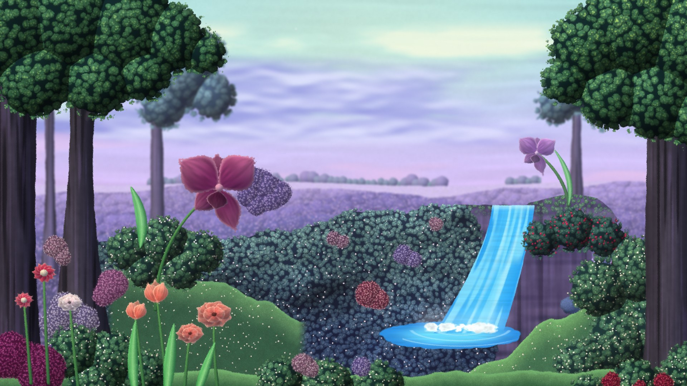
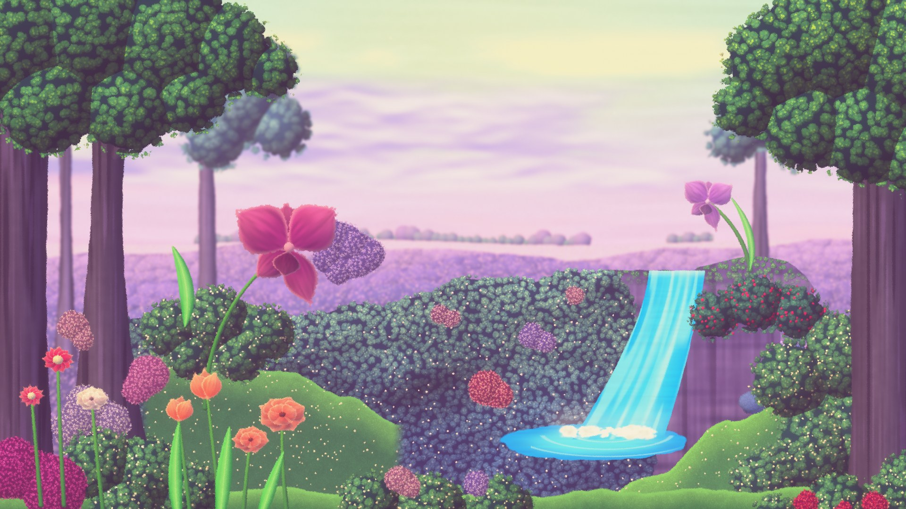
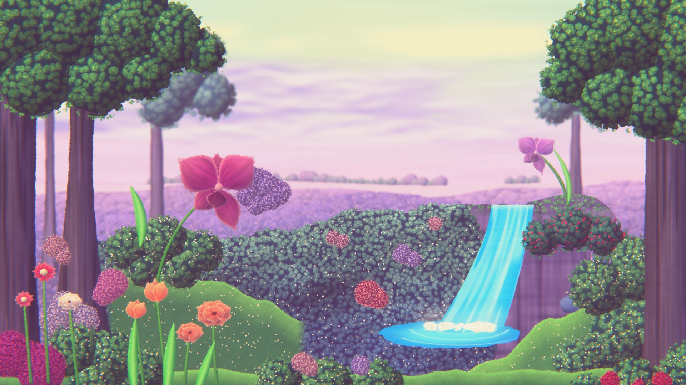
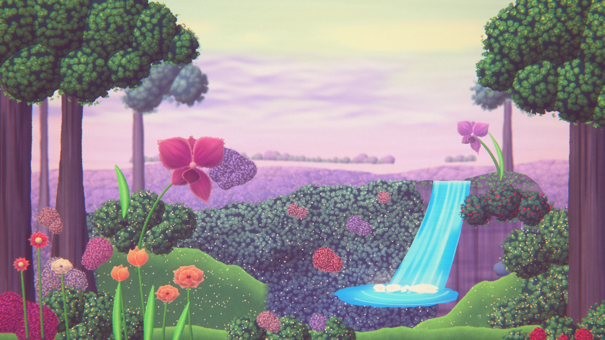

# Recipe: the garden backdrop study

*This is a study of a looping backdrop made by Tamara for a podcast set. The show isn't named here, and I'm not affiliated with it or with her. The study is the learning step. The original scenes I make afterwards are the actual project.*

This document has three parts. The first is the look-dev analysis: what's in the scene, what colors it actually uses, how it moves and which ingredients make it look the way it does. Everything in that half comes from three screenshots, so each claim is marked with how sure I can be about it. The second half, [Building the study](#building-the-study), covers what happened when I built it: the pass-by-pass screenshots, the measured comparison with the reference, and what changed from the hypothesis. The last, [The recipe in plain steps](#the-recipe-in-plain-steps), is the method on its own, as you'd follow it in the editor.

## What the screenshots can and can't tell us

The evidence is three frames from a video episode. The reference frames live in `reference/`, which isn't committed.

| Frame | What it shows | Size |
| --- | --- | --- |
| 1 | A wide shot of the screen at an angle, from a different camera. Nobody is in front of it, so the center of the scene is visible. | 523×355, very soft |
| 2 | The main camera, straight on. The host covers the middle third. | 2289×1126 |
| 3 | Same camera and framing as 2, a different moment. | 2290×1056 |

Four limits shape everything below:

- **They're stills, so no motion can be measured.** The motion section is a hypothesis until I can step through real footage (see [Open questions](#open-questions)).
- **It's a screen filmed by a studio camera.** The colors are the camera's view of a TV, after that camera's exposure, white balance and contrast. Frame 1 is the same scene through a different camera, and it looks much grayer and flatter. So the palette below is a target for *the final frame*, not the colors of the original art.
- **Video compression smears fine detail.** Grain, chromatic aberration and halation can't be measured; compression would have erased them if they were subtle.
- **The host hides the center.** Frame 1 fills in the composition but is too small and soft for color sampling, so colors come from frames 2 and 3 only.

## Layer breakdown, back to front

The scene reads as a multiplane setup: flat layers at different depths with the camera locked off. Frame 1 shows something the brief didn't list: the middle of the scene is a **dark, flat-topped plateau**, and the waterfall pours off its right edge into a pool at the bottom right.

| # | Layer | What's in it | Material it reads as | Likely motion |
| --- | --- | --- | --- | --- |
| 0 | Sky | Vertical gradient: pale mint glow at the top, periwinkle clouds, lavender, a more violet band at the horizon. Soft, brushy clouds. A few small soft white specks in the upper sky (I can see 2–3 in frame 3). | Painted backdrop, airbrush or gouache | Slow cloud drift (maybe), specks twinkle |
| 1 | Horizon | A pale band of distant flower fields and a low tree line (frame 1 only). | Painted | None |
| 2 | Far hills | Rolling dark indigo mounds covered in tiny lavender specks. | Flocking with tiny beads or flowers | Boil only |
| 3 | Plateau and cliff | The dark central mass, and the purple cliff face beside the waterfall. | Sculpted, painted clay or foam | Boil only |
| 4 | Back trees | Trees behind the framing trees, on the left. Their canopy is noticeably bluer and paler than the front trees. | Same as the front trees, pushed back by haze | Boil only |
| 5 | Waterfall and pool | A cyan sheet with soft lighter vertical streaks, falling into a pool. | Airbrushed paint or a digital element. It's the least handmade-looking thing in the scene. | Cycle of streak frames, foam at the base |
| 6 | Mid ground | The big orchid on the left and a smaller, farther one on the right. Dark hedges dotted with small white and yellow flowers. A bright green slope and a rounded rock on the right. | Orchids: silk flower or painted paper. Hedges: flocked bush with bead flowers. | Orchids sway on their stems, hedges boil |
| 7 | Framing trees | Chunky trunks on the left and right edges with vertical bark streaks. Deep green canopies made of many small lit tufts with dark gaps. | Canopy: model-railroad clump foliage or lichen more than flat felt. Trunks: sculpted and painted. | Canopy tufts flutter, trunks still |
| 8 | Foreground beds | Coral tulips with streaky color and paler edges, a red daisy with a pale center, pink and lilac hydrangea-like clusters, white blooms. Saturated green leaves that look glossy and slightly see-through. | Silk flowers, felt, plastic leaves and stems | Sway and leaf flutter, biggest amplitude |
| 9 | Particles | The sky specks. Possibly more that compression hid. | n/a | Twinkle |

**Correction to the brief:** I'd call the canopy "clumped foliage" rather than felt. In the zoomed crops it's made of many separate rounded tufts with deep shadow between them, like the foliage clumps sold for model railroads, or lichen. Felt and wool roving can get close if they're teased into clumps. The asset plan photographs both.

**Unknown:** whether the original is physical stop motion, a 3D render made to look handmade, or a painting animated in layers. For this project it doesn't matter. The recipe is about how it reads, and that's the same either way.

## Palette

Sampled with [tools/sample_palette.py](../tools/sample_palette.py). Each swatch is either the dominant color of a small region (k-means) or the mean of pixels picked by a hue mask, so edges, the host and stray specks don't pull the value. "Lit" means the brightest 15–20% of those pixels. Frames 2 and 3 agree within a few levels on everything except one cloud sample, where the clouds themselves differ.

| Group | Swatch | Sampled | Brief's guess |
| --- | --- | --- | --- |
| Sky | Top glow | `#B7E7DD` | `#D8EFA0` |
| | Glow, most yellow pixels | `#BBE6C9` | |
| | Upper cloud | `#BBD4F5` | `#D9A9D6` (pink) |
| | Lavender | `#C7C1FB` | `#B9A6E0` |
| | Horizon violet | `#C8B7F8` | |
| | Sky behind the back trees | `#9B82B3` | |
| Land | Far hills | `#2B2543` | |
| | Far hills, flower specks | `#9884E7` | |
| | Mid hills | `#36447C` | `#5B4A8C` |
| | Cliff | `#4A426D` | |
| | Grass slope / lit | `#477658` / `#568C6B` | |
| Water | Waterfall shadow / body / streaks | `#1BA0F4` / `#35BAFA` / `#5CD5FD` | `#3FD0F0` to `#8FE8F6` |
| Trees | Trunk / lit side | `#303040` / `#3F424F` | `#4A3F4E` |
| | Canopy shadow | `#111D23` | |
| | Canopy | `#2B513B` | `#2F4A2E` |
| | Canopy, lit tufts | `#467055` | `#5A9A3A` (moss) |
| Flowers | Orchid / lit | `#763767` / `#8F587E` | `#B03A6A` |
| | Far orchid (right) | `#8B5FA4` | |
| | Coral tulip / lit | `#8A474F` / `#A56267` | `#E07060` |
| | Red bloom | `#581636` | |
| | Pink cluster, lit | `#8469A0` | |
| Frame | Darkest 1% of the visible scene | `#13181D` | |
| | Studio wall around the screen | `#938475` | |

What the numbers say:

1. **The guesses run lighter and warmer than the pixels, almost everywhere.** The orchid is plum (`#763767`), not magenta. The coral is a dusty rose (`#8A474F`, lit `#A56267`), not `#E07060`. The swatches look duller on their own than they do in the scene, because in the scene every color sits next to its complement and the eye pushes them apart. That's useful for the build: the art can be more muted than it feels, as long as the contrast between neighbors stays.
2. **There's no pink in the sky.** In the upper right sky, 0.1% of pixels have red clearly above green. What reads as pink is the violet near the horizon (`#C8B7F8`) next to the green trees.
3. **The glow isn't yellow-green, it's mint.** The most yellow 3.6% of the top band averages `#BBE6C9`. The pull toward yellow is again the lavender next to it.
4. **The water is more saturated and bluer than guessed,** and it never gets as pale as `#8FE8F6`. The blue channel clips at 255 in the waterfall and sky.
5. **Things farther away shift toward the sky color.** The far orchid (`#8B5FA4`) is lighter and bluer than the near one (`#763767`), and the back trees' canopy is visibly blue-violet next to the front trees' green. That's aerial perspective, and it's missing from the brief's ingredient list.

## The look, measured

Measured over the visible scene in frames 2 and 3, a left and a right strip that leave out the host. Luma uses Rec. 709 weights on 0–255 values.

| Measure | Frame 2 | Frame 3 | What it means |
| --- | --- | --- | --- |
| Luma, 1st percentile | 25 | 25 | Blacks are lifted to about 10%. Nothing big is truly black. |
| Luma, 99.9th percentile | 221 | 220 | Highlights stop around 86%. Even the brightest sky isn't white. |
| Max value per channel R / G / B | 215 / 255 / 255 | 224 / 252 / 255 | Red never reaches the top. The whole frame leans cool. |
| Color of the darkest 1% | `#13181D` | `#13181D` | Shadows are a cool blue-gray, not lavender. |
| Median saturation (HSV) | 0.38 | 0.38 | Moderate. The darks are rich; only the sky is truly pastel. |
| Noise in a flat sky patch (std, R / G / B) | 2.3 / 3.7 / 1.8 | 2.4 / 2.9 / 1.6 | Very little visible grain, but compression removes grain, so this is a floor, not the real amount. |

**Correction to the brief: the frame is cool, not warm.** The red cap, cool shadows and lavender-blue sky all point the same way. The warmth I'd felt watching it comes from two places: the coral and red flowers in the foreground, and the beige studio wall around the screen (`#938475`). On the portfolio page, a warm surround around the canvas might do the same job. That's worth testing in phase 3.

## Post-stack hypothesis

The brief's order holds, with one ingredient added (aerial tint) and the confidence of each one stated. Starting values come from the measurements where there are any. Everything else gets tuned by eye against the reference in phase 3.

| Order | Pass | Evidence | Confidence | Starting point |
| --- | --- | --- | --- | --- |
| 1 | **Aerial tint** (new). Each layer blends toward the sky's horizon color by its depth. Applied per layer while compositing, before any post. | Far orchid vs near orchid, back trees vs front trees | High | Far layers 30–40% toward `#C8B7F8`, mid layers 10–15%, foreground 0% |
| 2 | **Depth softness** on far layers | Far hills and back trees are softer than the foreground, but compression softens everything, so the difference is hard to separate | Medium | Small blur on layers 0–4 only |
| 3 | **Bloom / diffusion** | A light haze where the canopy meets the sky, and the overall low contrast. It could also be the studio camera's lens. | Medium | Half-resolution blur, low strength, threshold low enough that the sky contributes |
| 4 | **Halation** | No warm fringe at any bright edge I checked (waterfall against cliff, canopy against sky, orchid against sky) | Low | Built and toggleable, off by default |
| 5 | **Color grade** | The strongest evidence of anything here | High | Lift the floor to about 0.10 tinted toward `#13181D`. Cap white at about 0.86. Cap red at about 0.85–0.88. Leave saturation near the art's own and adjust from there. |
| 6 | **Chromatic aberration** | Can't be seen at this compression | Low | Built, off by default |
| 7 | **Vignette** | Can't separate it from the content and the camera | Low | Built, very light |
| 8 | **Grain** | Can't be measured (see above) | Low | Very fine, decided by eye. Try per frame and per beat. |

The big takeaway: **the grade and the aerial tint do most of the work**, and the soft glow is a supporting player. That's the reverse of what I expected going in, and it's the kind of thing the tuning panel should make visible: turning off the grade should change the scene the most.

## Motion inventory (hypothesis)

Nothing here is measured yet. This is what the scene's contents suggest, ordered by how much of the frame each element covers.

| Element | Motion | Type | Notes |
| --- | --- | --- | --- |
| Foreground flowers and leaves | Sway on stems, leaves flutter | Rotation around a pivot at the stem base, stepped on the beat | Biggest amplitude, closest to camera |
| Orchids | Slow sway | Same, smaller amplitude, longer period | The right one is far away, so it moves less on screen |
| Waterfall | Streaks travel down, foam churns at the base | A short cycle of swapped frames (or a stepped UV scroll that looks like one) | Probably 4–8 frames in the cycle |
| Canopy tufts | Flutter | Small per-tuft offsets on the beat | Might be boil only |
| Sky | Cloud drift | Very slow stepped scroll | Frames 2 and 3 differ around the upper cloud, but the framing also shifts by a few pixels between them, so I can't call it drift |
| Sky specks | Twinkle | Per-speck brightness on the beat | |
| Everything | Boil | Small seeded per-beat offset to UVs, edges and rotation | So nothing ever sits perfectly still |

**Stop-motion rate:** the brief's guess of 2s or 3s (8–12 fps) is plausible but unmeasured. With a short clip, I can measure it: count how often each region of the frame actually changes (ffmpeg frame differencing), which gives the real animation rate per element and the loop length.

## Open questions

1. **A short clip.** 10–30 seconds of the backdrop, recorded from an episode, kept in `reference/` and never committed. It would turn the motion section from a guess into measurements: animation rate, loop length, sway amplitudes, waterfall cycle length. Until then, the build uses the starting values above.
2. ~~Credit.~~ Resolved: the backdrop is Tamara's work, credited at the top of this file and on the page. The show stays unnamed.
3. ~~The asset route.~~ Resolved for the study: see [Who made what](#who-made-what). The original scenes follow the hybrid plan in [ASSETS.md](ASSETS.md).

## Building the study

### Who made what

For this study I asked Claude (Anthropic's AI coding assistant) to build everything, art included, so I could see the whole pipeline working before making my own assets. That means:

- **All of the study's art is procedural.** Shapes are signed-distance functions with noise on their edges, and surfaces come from material functions (fibers, clumped foliage, paper grain, clay, beads) in [js/materials.js](../js/materials.js). There are no photographs, no hand-drawn images and no AI-generated images. Claude wrote the code that draws the art, and I directed it by comparing renders against the reference.
- **The original scenes will use my own assets**, photographed and drawn as described in [ASSETS.md](ASSETS.md). The README will say layer by layer what's procedural, photographed or drawn.

### What the renderer does

- **Bake once.** At load, a list of shaders paints every layer into a texture. Some are bespoke to this scene (sky, clouds, horizon, hills, rock, mound, pool, waterfall). Others are reusable elements any scene can place: canopy, florets, trunk, branch, turf and fuzz, plus a sprite shader for swaying flowers and leaves. The waterfall bakes six frames.
- **Composite on the beat.** Each layer is one textured quad. Its position is camera drift times its depth (parallax), plus its own animation: drift, sway around a pivot, or a cycle of baked frames. Boil wobbles each layer's texture lookup with smooth noise. Its seed changes on the beat and cycles through three values, like a drawing redrawn three times.
- **Everything loops in 6 seconds**, at 12, 8 or 6 beats per second, because every period divides the loop and boil has three seeds. Measured as the mean absolute difference between frames (0–255): each beat changes the picture by about 2.9. The step from the last beat back to the first is 2.93, so the seam is no bigger than any other step. Two moments inside one beat differ by 0.00, so the pose really holds.
- **Post stack**, in the order below. The scene and the bloom chain re-render only on a new beat. With grain set per beat (the default), nothing is drawn between beats.

### The passes, one at a time

Each image adds one pass to the one before. Same frame, 1920×1080, warm grade. ([docs/images/passes/](images/passes/))

| Pass | What changed |
| --- | --- |
|  **Base** | The baked layers with parallax and boil, no post. Already close to the reference's color structure: cool, purple hills, mint sky. |
|  **Depth softness** | A small blur on the sky, hills and back trees only. Subtle on its own, but it's what keeps the foreground reading as closer. |
|  **Bloom and mist** | The fuzz. Glow on the highlights, plus a wide blur screened over everything, which lifts the darks and puts a halo on every edge. |
|  **Halation** | A warm fringe outside bright areas. Barely visible here, which matches the reference, where I found none. |
|  **Grade** | By far the biggest single change. The darkest 1% of the frame goes from 12 to 61 (0–255), the sky turns gold and rose, and saturation goes up. |
|  **Chromatic aberration** | Red and blue pulled slightly apart toward the edges. At this strength you have to look for it. |
|  **Vignette** | Tinted peach rather than black, so the corners warm instead of darkening. |
|  **Grain** | Fine, and it changes once per beat. |

This confirms the main prediction from the analysis: **the grade does most of the work**, and the haze (mist and depth softness) supports it. Halation and chromatic aberration are close to invisible at the strengths that look right.

### Two grades: measured and warm

The brief for this study asked for a fuzzy, bright, warm, dreamlike look, but the reference measures as cool (see [The look, measured](#the-look-measured)). So the study has both:

- **Measured** (`?grade=measured`) is tuned to match the reference's numbers.
- **Warm** (the default) is the art direction: gold highlights, rose and plum lifted blacks, higher saturation and more mist.

To compare like with like, I placed each render in the reference's framing and ran the same sampler over the same regions, which leave out the host:

| | Reference (frame 2) | Study, measured grade | Study, warm grade |
| --- | --- | --- | --- |
| Luma p1 / p50 / p99 | 25 / 69 / 207 | 20 / 69 / 207 | 56 / 119 / 226 |
| Darkest 1% | `#13181D` | `#0F141A` | `#442F45` |
| Median saturation | 0.38 | 0.43 | 0.26 |

The measured grade matches the reference's midtones and highlights and runs about five levels darker in the deepest shadows. The warm grade is far from the reference on purpose. It's about 30 levels lighter in the darks and noticeably less saturated, because the mist washes out color as it lifts. A side-by-side image with the reference (`reference/compare.jpg`) stays local, with the screenshots.

### What still differs from the reference

- **The center.** The host hides it in every sharp frame, so the dark mound there is my guess from the blurry wide shot. It's the least convincing part of the scene: a large area of one texture.
- **Materials up close.** The canopy reads as clumped foliage at full screen, but its tufts are rounder and more regular than real lichen or foliage clumps. Photographed materials should improve this more than anything else.
- **Motion** uses the starting values from the motion inventory. Without a clip, I can't say how close the rates and amplitudes are.

### Performance

Measured in Chrome 155 on this laptop (Intel Iris Xe, integrated graphics) with GPU timer queries, three runs each:

| | 1920×1080 | 653×1412 (phone settings) |
| --- | --- | --- |
| Frame on a new beat: all layers, blur, bloom chain, final pass | 3.5–4.2 ms GPU (p50), 4.5 ms worst p95 | 1.6 ms GPU (p50) |
| Frame between beats, grain per beat (default) | nothing drawn | nothing drawn |
| Frame between beats, grain per frame | 0.8–1.1 ms GPU | not measured |
| Load: shader compile + bake | 0.6–1.4 s + 5–8 ms (varies by run) | not measured |

The phone column is the low-quality path (lower resolution, fewer bloom levels) measured on the laptop's GPU, not on a phone. I couldn't get a trustworthy frame-rate number from headless Chrome, because even an empty WebGL canvas drops frames there. `?stats=1` shows live frame times in a normal browser.

Load time took the most work. The first version took 35 seconds to start, almost all of it compiling shaders: the Windows shader compiler inlines every function call, and one flower shader alone took 16.6 seconds. Three changes brought compiling down to between 0.6 and 1.4 seconds:

- Each heavy function now has one call site: one draw per element, instead of one huge shader per layer.
- Small loops use a uniform bound, so the compiler can't unroll them.
- Every program compiles in parallel through `KHR_parallel_shader_compile`.

### Quality checks so far

- **Reduced motion.** With `prefers-reduced-motion`, the scene renders one still frame, nothing animates, and the button reads "Play animation". Pressing it from the keyboard starts the animation.
- **No WebGL.** In Chrome with WebGL turned off, the page shows `images/still.jpg` with the caption.
- **Lost GPU context.** The page falls back to the still image.
- **Hidden or off screen.** In a scripted check the loop ran 60 frames in a second while visible, 0 while the tab reported hidden, 61 after it came back, and 0 with the canvas scrolled off screen.
- **Caption contrast.** The caption text is cream (`#F3EEDD`) and tan (`#A79E8A`) on a 90% opaque near-black backing. Even with white showing through it, that's at least 12:1 and 5.3:1. The tuning panel became the editor's Look panel; its checks are in the README.

## The recipe in plain steps

This is the whole method, separated from this one scene. Each step names the editor control that does it ([editor.html](../editor.html)), so a new scene can follow it from top to bottom.

1. **Plan the planes.** Sketch the scene as 4 to 8 flat layers from back to front: sky, far hills, middle ground, framing pieces, foreground. Each becomes a layer with a depth from 0 (sky) to 1 (touching the lens). *Editor: New layer in Layers, then Depth in the Layer tab. The depth view above the layer list shows the planes at a glance.*
2. **Make each piece from a shape and a material.** Silhouettes are hand-cut shapes with uneven edges, and surfaces are real materials: paper, felt, clay, clumped foliage, or a photo of your own. Nothing should have a clean vector edge. *Editor: the shape tools, then the Material swatches and Rough edge and Fiber fuzz under Handmade feel, in the Piece tab.*
3. **Light everything from one side.** One warm key light from the top left and a cool fill from the right, the same for every piece, so pieces made separately agree. Puffed pieces catch the light on their top-left edge, and shadows fall down and right. *Editor: Puff and Cast shadow, under Handmade feel.*
4. **Push the far layers back.** Far layers fade toward the horizon color and get a little blur, so the foreground reads as closer. *Editor: Haze and Soften with distance, in each layer's Depth card.*
5. **Move on the beat, not smoothly.** Poses change 12, 8 or 6 times a second and hold in between. Flowers sway from their stems, clouds drift, and anything cycling swaps whole frames. Every motion repeats a whole number of times in 6 seconds, so the loop is seamless. *Editor: Motion in the Layer tab; the beat rate under the timeline or in Look.*
6. **Let it boil.** Every beat, each layer wobbles by a pixel or two, cycling through three versions, like a drawing redrawn three times. Nearer layers boil more. *Editor: Boil on each layer, Boil for the whole scene in Look.*
7. **Grade it last, and grade it hard.** The grade does more than any other step: lifted blacks, split toning, a push in warmth and saturation (or the opposite for night). *Editor: a preset in Look, then Color grade.*
8. **Add the haze of a lens.** Mist over everything lifts the darks and haloes every edge, and glow lights the highlights. Halation, color fringing, a tinted vignette and grain are all subtle. Turn each one off once to check it earns its place. *Editor: the cards in Look, each with a switch in its header.*
